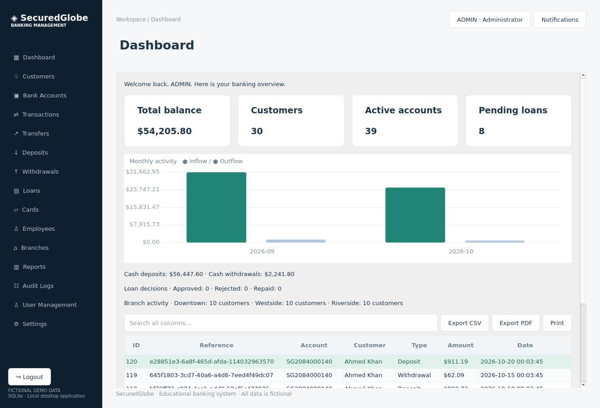

# Validation record

Test date: 31 October 2026 (Asia/Karachi).

## Environment

- Ubuntu 24.04, x86-64 Linux
- GCC 13.3.0, C++17, Release configuration
- Qt / Qt Test 6.4.2
- CMake 3.28.3 with Ninja 1.11.1
- Qt SQLite driver; offscreen Qt platform for GUI automation

The project was compiled and linked as native C++, not translated to JavaScript. The desktop executable was launched and rendered offscreen. The dashboard image below was generated by the executable using its fictional SQLite dataset.

## Result

Native Release build succeeded. Final CTest run: **3/3 checks passed**, 0 failed, total elapsed 68.95 seconds. Service test cases: 12 passed. GUI workflow test cases: 4 passed. See `test-results.txt` for the captured test log.

## Automated checks

CTest defines three checks:

1. `banking_services`: 12 service integration test cases, in addition to fixture setup/cleanup. These exercise authentication, password changes, lockout, authorization and ownership, customer/KYC/account workflows, money parsing and overflow, cash operations, frozen/closed states, transfer atomicity, duplicate prevention, loan calculations and repayments, cards, backup, persistence, date/type/amount filters, audit, and administrator-assisted user/reset flows.
2. `gui_workflows`: four button-driven Qt GUI tests. They enter forms, click confirmation buttons, and verify persisted results for deposit plus receipt, transfer plus paired balances, customer registration plus KYC plus account opening, and loan application plus approval/disbursement plus repayment.
3. `gui_smoke`: launch with a temporary SQLite database and construct all 37 authenticated destinations (screen IDs 4–40), render the dashboard, and construct login/reset dialogs. Startup renders the splash screen.

The transfer rollback test installs an SQLite trigger that deliberately fails the credit ledger insert. It then verifies that both balances, the transaction count, and the transfer request table remain unchanged. This tests rollback after the debit, not merely rejection before any write.

Loan tests verify that installments sum to the stored total, principal portions sum to the principal, each installment equals principal plus interest, and remaining principal reaches zero. The zero-rate case checks exact principal recovery.

The lockout expiry test advances the stored lock deadline into the past; it does not wait five real minutes. Password hashing uses the same 600,000-iteration configuration in tests and normal operation. Each test receives an independent copy of the initialized fixture database.

## Verification limits

Windows (MSVC/MinGW) and macOS build instructions are documented but were not executed in this Linux environment. Native printer dialogs, physical printing, and every possible operating-system file dialog were not manually tested. The smoke test checks construction/rendering and navigation targets; it is not a claim that every possible action sequence across all 40 screens was automated. Critical business rules are exercised by service tests; four core GUI workflows are exercised end to end.

The system uses fictional data and is intended for education and demonstrations. It has no real payment integration, credit bureau integration, regulatory certification, database encryption, or networked multi-workstation deployment.
